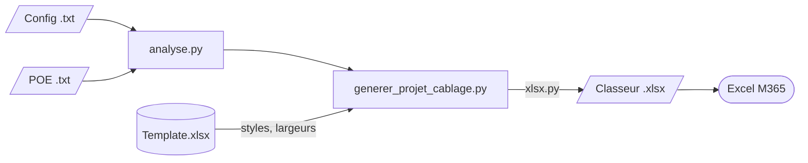

# Wiki Changement Câblage

Générateur du classeur Excel de réaménagement du câblage : à partir des sorties brutes d'un lot de switchs
(`show running-config`, `show power inline`), il produit `Projet_Réaménagement_Câblage_<XXXX>.xlsx`, qui sert à
l'**entrepreneur** pour rebrasser les prises et au **technicien** pour transférer les configs. Ce wiki est la
**seule** documentation du projet (source : `docs/WIKI.md`, page : `docs/wiki.html`). Les règles de travail des
agents sont dans [CLAUDE.md](../CLAUDE.md).

| Partie | Pour qui, pour quoi |
| --- | --- |
| 1. Présentation | Le besoin, les décisions prises, le contenu du dépôt |
| 2. Installation et exploitation | Préparer un projet, lancer le générateur, dépanner |
| 3. Utilisation | Le classeur produit, feuille par feuille, et les règles métier (POE, prises, doublons) |
| 4. Développement | Architecture, formules, pièges, recettes d'ajustement |
| 5. Tests | Lancer la suite, ce qui est couvert, ce qui ne l'est pas |
| 6. Suivi du projet | Passation, prochaines étapes, régénérer le wiki |

# 1. Présentation

## Ce que fait le projet

Lors d'un réaménagement, chaque prise murale branchée sur un ancien switch doit être rebrassée sur un nouveau port.
Le générateur lit la config de chaque switch, retrouve dans la `description` de chaque port le **local** et le
**numéro de prise**, relève si le port alimente un équipement en PoE, et prépare :

- un plan de brassage imprimable (une ligne par prise, cases à remplir au crayon) ;
- pour chaque port, la config actuelle et la config réécrite (nouvelle interface, nouvelle description) ;
- les blocs de config à coller switch par switch.

Ce qu'il ne fait pas : il ne se connecte à aucun équipement, ne pousse aucune config et ne devine pas la
planification (nouvelle prise, nouveau switch, nouvelle interface) : c'est la partie qu'on remplit à la main dans
le classeur.

## Contexte et décisions

| Décision | Pourquoi | Date |
| --- | --- | --- |
| Python bibliothèque standard, écrivain XLSX maison (`xlsx.py`), pas d'`openpyxl` | Les formules dynamiques (`LET`, `MAP`, `TEXTSPLIT`…) doivent ressortir mot pour mot ; une bibliothèque générique risque de les réécrire | antérieure |
| Présentation empruntée à `Template.xlsx` (le classeur tenu à la main) | Le classeur produit ressemble à celui que l'équipe connaît | antérieure |
| Références de feuille **en dur**, plus d'`INDIRECT` | L'`INDIRECT` d'origine reconstruisait le nom de feuille depuis le nom de switch et tombait à côté (colonne POE entière en `N/C` en production) | antérieure |
| Une seule feuille `Changements All Switch` au lieu d'une par switch | Passer d'onglet en onglet ; regrouper par « zone » exigeait de deviner une zone depuis le nom de switch | antérieure |
| Recherche par **port** (switch + interface) et non par numéro de prise | L'extraction du numéro confondait `P0006` et `P0006B` ; les ports hors gabarit restaient sans lien | antérieure |
| Les doublons de prise sont gardés et se nomment l'un l'autre | Écarter le second faisait disparaître un port réel du plan | antérieure |
| Colonne POE en trois valeurs : `NON-POE` / `POE` / `POE+` (remplace `POE` / `POE (AP)`) | Brancher un AP ou un équipement de classe 4 sur un port PoE classique le prive de puissance en pointe | 2026-11-16 |
| Largeurs de colonnes déclarées par nom d'en-tête | Les tables par numéro ne suivaient plus les colonnes insérées | 2026-11-16 |
| Audit d'optimisation : impression, `New Config`, contrôles de saisie, mises en forme, volets (sans toucher à la structure) | Voir « Optimisations de l'audit » (partie 4) | 2026-11-16 |
| Pas de référence directe à la ligne de CÂBLAGE à la place des recherches (gain de recalcul) | L'équipe **trie** CÂBLAGE : une référence directe pointerait alors un autre port | 2026-11-16 |

## Vue d'ensemble



## Contenu du dépôt

```fichiers
generer_projet_cablage.py | point d'entrée : projets, feuilles, diff, restauration, écriture
analyse.py | lecture des .txt : interfaces, prise, local, vocation, show power inline, règle POE
formules.py | formules Excel et disposition des colonnes (CAB_ENTETES, CHG_ENTETES)
habillage.py | styles de cellule « Avant / Après », par nom d'en-tête
gabarit.py | lecture de Template.xlsx : styles, thème, largeurs, mise en page
xlsx.py | écrivain / lecteur XLSX maison
Template.xlsx | gabarit de présentation, obligatoire
tests/test_poe.py | règle POE, lecture du show power inline, parité des abréviations
tests/test_generation.py | génération complète d'un projet fictif
maintenance.json | environnement et dépendances (lu par le portail du Hub)
CLAUDE.md | règles de travail des agents sur ce projet
.claude/skills/ | copies de skills de Myst-skills : catalyst-center, donnees-sensibles, tests-fiables
docs/WIKI.md | ce wiki (source)
docs/wiki/wiki.json | réglages du wiki
```

# 2. Installation et exploitation

## Préparer un projet

Rien à installer : Python 3 suffit. Ranger les sorties de chaque switch ainsi, à côté du script :

```text
Changement Cablage/
├── Genie/                                  <- le nom du dossier donne le « XXXX »
│   ├── Config/  Z7-0002-9200A.txt          « show running-config » par switch
│   └── POE/     Z7-0002-9200A.txt          « show power inline » par switch
└── Projet_Réaménagement_Câblage_Genie.xlsx <- produit ici
```

- Tout sous-dossier de la racine est un projet, sauf ceux qui commencent par `.` `_` `~` `$`.
- Les configs sont lues dans `Config/` s'il existe, sinon à la racine du dossier projet.
- `POE/` est facultatif : sans lui, toute la colonne POE ressort `NON-POE`.
- Le nom du `.txt` (sans extension) **est** le nom du switch dans tout le classeur. Si la config annonce un autre
  `hostname`, le générateur le signale : c'est une erreur de collecte.

> [!WARNING]
> Ces fichiers sont des données réelles du parc : ils ne se commitent pas (`.gitignore` exclut `*.txt` et
> `*.xlsx`) et un agent ne les ouvre pas (skill `donnees-sensibles`).

## Lancer le générateur

```bash
python generer_projet_cablage.py                      # diff de tous les projets, rien n'est écrit
python generer_projet_cablage.py Genie                # diff du seul projet Genie
python generer_projet_cablage.py Genie --force        # écrit le classeur
python generer_projet_cablage.py Genie --descriptions # liste tout ce qui est lu dans les descriptions
```

Autres options : `--gabarit X.xlsx` (autre gabarit), `--sans-sauts-page` (CÂBLAGE imprimée d'un seul tenant),
`--racine DOSSIER`, `--sortie FICHIER.xlsx`, `--reserve N` (lignes vides en fin de CÂBLAGE, défaut 50).

**Sans `--force`**, le script compare avec le classeur existant et affiche ce qui changerait, sur ce qui vient des
`.txt` seulement (PoE, configs, prises, locaux) : le travail fait à la main ne noie pas le diff.

**Avec `--force`** :

1. l'ancien classeur est copié en `.<horodatage>.bak` ;
2. le nouveau est construit ;
3. les saisies de l'ancien sont **réinjectées** par la clé stable (switch, interface) : `Nouv. Prise`,
   `Nouv. Switch`, `Nouv. Interface`, `Nouv. Locale`, `VOCATION`, `État`, `Commentaire` (sauf les marques
   `DOUBLON` / `HORS GABARIT`, recalculées) et, dans Changements, `Description override` ;
4. écriture dans un `.tmp` puis remplacement : jamais de classeur tronqué.

## Dépannage

| Symptôme | Cause / solution |
| --- | --- |
| « fichier verrouillé » | Le classeur est ouvert dans Excel : le fermer et relancer. Rien n'a été écrit, pas de `.bak` orphelin. |
| `POE/x.txt : pas d'entête « Interface Admin Oper Power »` | Le fichier n'est pas un `show power inline` : refaire la collecte. |
| Switch noté « aucun (switch sans PoE) » | Normal pour les 2960/2961/2962 : en-tête présent, aucune ligne. |
| Un port manque dans CÂBLAGE | Sa description ne livre pas de numéro de prise : il est dans la section « hors gabarit ». `--descriptions` montre ce qui a été lu. |
| Colonne POE pleine de `N/C` ou `#NOM?` | `#NOM?` : Excel trop ancien (2019 LTSC ne connaît pas `LET`). Ouvrir dans Excel M365 / Online. |
| Onglet de config renommé | Nom de plus de 31 caractères, caractère interdit ou parenthèse finale (`C1-3000-6984A (Julie)` → `C1-3000-6984A`). La colonne Switch garde le nom complet. |

## Si le script échoue : à la main

Le générateur n'a pas d'équivalent manuel raisonnable (des centaines de formules). En cas d'échec :

1. lire le message : la plupart des arrêts disent quel fichier pose problème ;
2. relancer sans `--force` pour voir le diff, puis avec `--descriptions` pour voir ce qui est lu ;
3. retirer temporairement le `.txt` en cause du dossier `Config/` pour isoler le switch ;
4. le dernier classeur valide reste disponible en `.bak`.

## Maintenance : dépendances, versions, vulnérabilités

| Élément | Version | Rôle | Remarque |
| --- | --- | --- | --- |
| Python | 3 ; testé sous 3.13 | exécuter le générateur | version minimale non mesurée |
| Bibliothèque standard | — | tout le générateur | aucune dépendance à installer |
| Excel M365 / Excel Online | — | calculer le classeur | Excel 2019 LTSC affiche `#NOM?` |
| markdown-it-py, mdit-py-plugins, Pillow | non figées | régénérer ce wiki seulement | pas nécessaires au générateur |

Déclaré aussi dans `maintenance.json`. Vulnérabilités : aucune dépendance d'exécution, rien à surveiller côté
générateur.

# 3. Utilisation

## Les feuilles du classeur

| Feuille | Pour qui | Contenu |
| --- | --- | --- |
| `CÂBLAGE <XXXX>` | entrepreneur (imprimée) | une ligne par prise, groupée par local technique ; section « hors gabarit » en fin |
| `IMPRESSION` | entrepreneur | `CÂBLAGE` ligne pour ligne, filtrée sur `État` = `À faire` |
| `Changements All Switch` | technicien (écran) | une ligne par port, tous switchs à la suite : config actuelle et réécrite |
| `Config à copier` | technicien | une section par switch, `configure terminal` … `end`, lignes `À prog` et `À désactiver` |
| `<switch>` | formules | config brute, une ligne par cellule |

La planification se saisit **dans CÂBLAGE** ; Changements la relit.

## La feuille CÂBLAGE

| Colonne | Sens | Rempli par |
| --- | --- | --- |
| `Local Switch` | local technique : deux premiers segments du nom de switch (`Z7-0002`) | générateur |
| `Anc. Switch` | nom complet de l'ancien switch | générateur |
| `Interface` | interface abrégée (`Gi1/0/6`) | générateur |
| `Description` | description brute du port | générateur |
| `Anc. Prise` | code après le `P` (`643`, `6B`) | générateur |
| `Anc. Locale` | local **de la prise** | générateur |
| `Nouv. Prise`, `Nouv. Switch`, `Nouv. Interface` | planification | à la main |
| `POE` | `NON-POE` / `POE` / `POE+` | formule |
| `Nouv. Locale` | planification | à la main |
| `VOCATION` | usage : texte entre parenthèses de la description (`AP`, `imprimante`) | pré-rempli, modifiable |
| `État` | `Fait`, `À faire`, `À prog`, `À désactiver`, `À vérifier`, `Non-fait` (défaut), `Ne pas faire` | à la main |
| `Commentaire` | `DOUBLON <switch> <int>`, `HORS GABARIT`, ou libre | générateur / à la main |

> [!IMPORTANT]
> `Anc. Switch` porte un **switch**, `Anc. Locale` un **local** : deux choses différentes. `État` ne porte que
> l'avancement ; ce que le script signale va en `Commentaire`.

Présentation : bleu = existant, vert = nouveau, gris = suivi ; case de planification vide sur une ligne de prise en
jaune (sauf sur les lignes `Ne pas faire` et `À désactiver`) ; `Fait` en vert gras, `Ne pas faire` en gris italique,
`DOUBLON` / `HORS GABARIT` et POE `N/C` en rouge. Lignes de 26 pt pour annoter au crayon ; un bandeau et un saut de
page par local technique. Les colonnes `Local Switch`, `Anc. Switch` et `Interface` restent figées à gauche.

**Contrôles de saisie** (avertissement : on peut passer outre après confirmation) :

- `Nouv. Interface` : doit commencer par un abrégé connu (`Gi`, `Te`, `Tw`, `Fa`, `Po`, `Ap`, `Hu`, `Fo`, ou le
  nom long) ou par un chiffre. `Gx1/0/5` déclenche l'avertissement au lieu de produire `interface Gx1/0/5`.
- `Nouv. Prise` : 4 caractères au plus (`643`, `0643`, `6B`).
- `Nouv. Locale`, `Nouv. Switch` : message d'aide seul.

## La feuille Changements All Switch

`Switch | Interface | Admin | Anc. Prise | POE | Device | Config | Nouv. Interface | Local | Nouv. Prise |
Description override | New Config | État | Commentaire`

- `Config` : le bloc de l'interface, pris dans la feuille du switch.
- `New Config` : le bloc réécrit, avec la nouvelle interface et `description <Local>_P<NNNN>` (toujours 4
  caractères après le `P` : `P0643`, `P006B`). `Description override` rempli remplace ce texte.
- `État` = `À désactiver` : `New Config` devient `default interface <X>`.
- `Nouv. Interface`, `Local`, `Nouv. Prise`, `État`, `Commentaire` sont relus dans CÂBLAGE par port.
- `New Config` en vert franc gras quand il diffère de `Config` (ce que le transfert va changer) ; `Config` en rouge
  quand il affiche « interface introuvable ».

## La colonne POE : quel port prévoir

C'est une **consigne de brassage** : sur quel type de port rebrancher.

| Valeur | Quand |
| --- | --- |
| `NON-POE` | le port ne débite rien (0 W), ou pas de donnée PoE — même si le port sait fournir 30 W |
| `POE+` | le port débite **et** : plus de 15,4 W, **ou** classe 4 à 8, **ou** `(AP)` dans la description, **ou** modèle reconnu dans `Device` (AP Cisco / Meraki, `AP`, PTZ) |
| `POE` | le port débite, aucune des raisons ci-dessus |

15,4 W est le plafond du PoE classique (802.3af) mesuré côté switch. La mesure n'est qu'un instantané : un AP
relevé à 9 W la nuit tire bien plus quand ses radios sont actives, d'où les critères classe et modèle.

```extrait
analyse.py | def besoin_poe_plus( | def etat_poe(
```

> [!NOTE]
> Pas d'état « inconnu » : « rien de branché » et « équipement non-PoE » donnent la même consigne au technicien.

## Numéro de prise dans la description

Notations reconnues, suivies ou non d'une annotation libre du technicien :

```text
D1-3001_P0560    D1-3001 P560    D1-3001-P560    D1-3001(P560)    D1-3001 (P560)
z1-2116-03_P0123 (xxxx)      C1-5015-00_P0197 (max 4)      C2-2065-00_P0338 trap enable
```

1. Un séparateur (espace, `_`, `-`, `(`) est **obligatoire** avant le `P` : sinon `AIR-AP2802I-A-K9` donnerait la
   prise 2802.
2. Un chiffre doit suivre le `P` : `PDU20A`, `PoE12`, `Panneau3` sont exclus.
3. Le code collé est gardé entier : `P06B` → `6B` ; zéros de tête retirés.
4. Code alphabétique (`_PABCD`) : seulement derrière `_`, `-` ou `(`.

```extrait
analyse.py | RE_PRISE = re.compile | RE_VOCATION
```

**Descriptions dégradées** : la forme normale du local est `C#-####-##` (`-00` final normal). Un 2e segment
absent, à zéro ou non numérique est **signalé** à l'exécution, jamais corrigé : la donnée fausse est sur l'équipement.

## Hors gabarit et doublons

- **Hors gabarit** : ports décrits sans numéro de prise (uplinks, inter-switch, trunks). Listés en fin de CÂBLAGE
  sous `— HORS GABARIT —`, avec switch, interface et description. Ils sont reliés à Changements comme les autres.
- **Doublons** : deux ports qui revendiquent la même prise (description restée sur un port re-brassé). Les deux
  lignes restent, chacune nomme l'autre (`DOUBLON Z7-1920-2962B Gi1/0/1`). AP et prises ont des numérotations
  séparées ; `P0000` n'est le doublon de personne.

```valider
- Liste des modèles reconnus comme POE+ dans `Device` (AP Cisco / Meraki, PTZ) : à compléter avec les équipements du parc (caméras, bornes, écrans…).
- Équipements de classe 5 à 8 (UPOE) : un libellé distinct `UPOE` est-il utile ?
- Les AP perdent le libellé `POE (AP)` au profit de `POE+` ; l'info AP reste en VOCATION. À confirmer avec l'équipe.
```

# 4. Développement

## Architecture

```carte-code generer_projet_cablage.py | depuis traiter | profondeur=1 | sans _prives
```

`construire()` réserve les noms de feuille, calcule pour chaque switch ses lignes dans Changements, puis assemble
les feuilles dans l'ordre :

```extrait
generer_projet_cablage.py | def construire( | # --- Diff
```

> [!WARNING]
> `construire()` calcule `(feuille, première, dernière)` de chaque switch dans le **même ordre** que
> `feuille_changements()` écrit les lignes. Changer l'un sans l'autre fait viser les lignes d'un autre switch par
> la formule POE.

## Disposition des colonnes : une seule source

Aucune lettre de colonne n'est écrite dans une formule : elles viennent de `CAB` / `CHG`, construits depuis les
listes d'en-têtes. Les colonnes ont bougé plusieurs fois ; une lettre oubliée donnait un classeur qui s'ouvre sans
erreur et affiche des valeurs fausses.

```extrait
formules.py | CAB_ENTETES = [ | def _lettres(
```

Les largeurs suivent la même règle, par nom ; un `assert` à l'import refuse une colonne sans largeur :

```extrait
generer_projet_cablage.py | CAB_DEPUIS_GABARIT = { | CAB_LARGEURS = _par_position
```

## Les formules

- **Préfixes `_xlfn.` / `_xlpm.` obligatoires** : c'est ainsi qu'Excel stocke `LET`, `XLOOKUP`… dans le XML ; sans
  eux, classeur corrompu.
- **Cellules matricielles** : `cm="1"` + `<f t="array" aca="1" ref=… ca="1">` et la partie `xl/metadata.xml`.
  Sans ce marquage, Excel les dégrade en matricielles héritées (CSE).
- **Plage concaténée** (`A&"|"&B`) : écrite en ARRAY, sinon intersection implicite et la recherche rend `""`.
- **Config** (`CHG_J`) : `MATCH("interface " & …)` exact puis recherche du `!` de fin de bloc. `lire_config()` ne
  normalise que les fins de ligne : ne jamais toucher à l'indentation ni aux `!`.
- **Table d'abréviations** (`Gi` → `GigabitEthernet`…) en deux copies : `analyse.ABREGES` et les `XLOOKUP` de
  `CHG_J` / `CHG_N`, verrouillées par un test de parité.
- **Config à copier** : une seule formule `REDUCE` de longueur fixe (l'ancienne dépassait 8 192 caractères vers 15
  switchs). Une ligne de config par cellule : copier une cellule multi-ligne ajoute des guillemets dans le CLI.

La formule POE de CÂBLAGE : recherche par port dans les lignes du switch, `IF(…=0,"",…)` final contre le `0`
qu'Excel rend pour une cellule vide.

```extrait
formules.py | CAB_F = ''' | # --- Feuille « Changements
```

## Présentation empruntée au gabarit

`gabarit.py` reprend de `Template.xlsx` : `styles.xml` et `theme1.xml` entiers, largeurs de `<cols>` (sans les
styles de colonne), `<sheetPr>`, mise en page. Écartés exprès : `<sheetProtection>` (empêcherait la saisie),
`<autoFilter>` (régénéré), en-tête d'impression (réécrit avec le nom du projet). `habillage.py` ajoute ses styles
**en fin** de liste : aucun index existant ne bouge. Le quadrillage vient des bordures des styles : toutes les
cellules sont émises, même vides (`xlsx.vide`).

## Optimisations de l'audit (2026-11-16)

Audit en lecture seule du classeur produit (projet fictif de 384 prises : 189 Ko, aucune fonction volatile). Appliqué
sans changer la structure :

| Point | Avant | Après |
| --- | --- | --- |
| Impression de CÂBLAGE | `<pageSetUpPr fitToPage="1"/>` hérité du gabarit : « Ajuster à une page » annulait l'échelle 69 % et les sauts par local | retiré (`sans_ajuster()`) |
| `New Config` | toute ligne contenant « description » était remplacée (`macro description …` compris) | seule la ligne qui **commence** par `description ` |
| Lignes `interface` | espaces de fin : Python trouvait le port, Excel affichait « interface introuvable » | espaces de fin retirés dans la feuille de config |
| Mises en forme | jaune même sur `Ne pas faire` ; plage `A3:A20000` en dur dans `Config à copier` | exclusions, `N/C` / introuvable en rouge, `New Config` modifiée surlignée, colonne entière |
| Saisie | aucune vérification | contrôles en avertissement (`controles_saisie()`, abrégés tirés de `analyse.ABREGES`) |
| Volets | seule la ligne 1 figée dans CÂBLAGE | + colonnes jusqu'à `Interface` |

**Écarté** : référence directe à la ligne de CÂBLAGE au lieu des `XLOOKUP` de Changements et de la formule POE. C'est
le plus gros gain de recalcul estimé (non mesuré), mais un **tri** de CÂBLAGE ferait pointer un autre port.

**Pas encore appliqué** (attend une décision ou une mesure sur M365) : protection des cellules à formule (un tri sur
une feuille protégée est refusé par Excel dès qu'il touche une cellule verrouillée), table d'abréviations en nom
défini `LAMBDA`, attribut `ca="1"` des formules.

**Restructurations notées, non faites** : colonne masquée « ligne CÂBLAGE » ; `New Config` découpée en colonnes
intermédiaires ; feuille « Listes » avec plages nommées ; tableaux structurés et segments ; `IMPRESSION` en une
seule formule `FILTER`.

**Automatisation** : pas de VBA (ne s'exécute pas dans Excel Online, `.xlsm`, impossible à écrire en bibliothèque
standard) ; Office Scripts possible pour « Préparer l'impression » (stocké hors du classeur, à autoriser par
l'administrateur) ; Power Query non pertinent.

## Recettes d'ajustement

| Je veux… | Fichiers, dans l'ordre | Test |
| --- | --- | --- |
| Ajouter ou déplacer une colonne | `formules.py` (`CAB_ENTETES` / `CHG_ENTETES`), `habillage.py` (familles), largeur par nom dans `generer_projet_cablage.py`, `IMP_COLONNES` si imprimée | `test_generation` : largeurs de toutes les colonnes |
| Reconnaître un nouveau modèle POE+ | `analyse.RE_DEVICE_POE_PLUS` | un cas dans `ReglePoePlus.test_modeles_ap_reconnus_dans_device` |
| Ajouter un état | `ETATS` dans `generer_projet_cablage.py`, mise en forme dans `habillage.py` si besoin | `test_generation` |
| Ajouter une abréviation d'interface | `analyse.ABREGES` **et** les deux tables de `CHG_J` / `CHG_N` | `PariteAbreges` |

# 5. Tests

## Lancer les tests

```bash
python -m unittest discover -s tests -v
```

Résultat attendu le 2026-11-16 : **27 tests, 27 passés, 0 sauté**.

| Fichier | Couvre |
| --- | --- |
| `tests/test_poe.py` | règle NON-POE / POE / POE+ (cas limites, faux amis), lecture d'un `show power inline` (CRLF, BOM, dossier accentué), parité des abréviations |
| `tests/test_generation.py` | génération complète d'un projet fictif : feuilles dans l'ordre, largeur de chaque colonne, valeurs POE, section hors gabarit, optimisations de l'audit (impression, `New Config`, espaces de fin, mises en forme, contrôles de saisie, volets) |

Données fictives uniquement (`LAB-0101-9300A`, `LAB-0101-00_P0001`).

## Ce qui n'est pas couvert

- **Le calcul des formules** : Excel du poste de dev = 2019 LTSC, sans `LET` ni `TEXTSPLIT`. Seul Excel M365 /
  Online le valide.
- La vérification croisée des références de feuille (chaque formule POE vise les lignes de son switch).
- Le diff et la restauration `--force`.
- Le rendu imprimé, les contrôles de saisie et les mises en forme dans Excel (seul le XML est vérifié).

# 6. Suivi du projet

## Passation : état de fin de session

### Session du 2026-11-16 : POE+, raccordement, wiki, à reprendre ici

- **Demandé** : afficher POE ou POE+ selon la conso et le type d'équipement ; raccorder le projet à
  `methode-de-travail` ; revoir l'ancien `CLAUDE.md` ; corriger les largeurs de colonnes ; créer ce wiki ; audit
  d'optimisation du classeur.
- **Fait** : règle POE+ (`analyse.py`) ; `CLAUDE.md` réécrit (l'ancien décrivait 11 colonnes, 3 états, pas
  d'`IMPRESSION` ni de `Config à copier`) ; copies de skills ; largeurs par nom d'en-tête ; code mort retiré ;
  `__pycache__` sorti du dépôt ; tests ; ce wiki.
- **Testé** : 21 tests passés ; génération sur un projet fictif.
- **Pas testé** : calcul des formules dans Excel M365 ; rendu imprimé après le changement des largeurs (CÂBLAGE a
  désormais une largeur pour ses 14 colonnes, dont `Description` à 30).
- **Audit d'optimisation** (même session) : appliqué sans changer la structure (partie 4, « Optimisations de
  l'audit ») ; 27 tests passés, les 6 nouveaux échouent sur l'ancien code ; XML du classeur bien formé. Référence
  directe à la ligne écartée parce que l'équipe trie CÂBLAGE.
- **Attend une décision** : points « à valider » de la partie 3 ; protection des cellules, nom `LAMBDA`, `ca="1"`.

## Prochaines étapes

- [ ] Vérification croisée des références de feuille dans `tests/test_generation.py` (paire piégeuse `…-6984` / `…-6984A` en fictif).
- [ ] Ouvrir un classeur produit dans Excel M365 : colonne POE, aperçu d'impression de CÂBLAGE (échelle 69 %, sauts par local), contrôles de saisie, mises en forme.
- [ ] Décider : protection des cellules à formule (incompatible avec un tri qui touche une cellule verrouillée), nom défini `LAMBDA`, mesure de `ca="1"`.
- [ ] Ajouter le projet à `Hub/projets.json` (dépôt `Myst-LB/Hub`).

## Régénérer ce wiki

```bash
pip install markdown-it-py mdit-py-plugins Pillow
python docs/wiki/gen.py          # zéro « ATTENTION » attendu
```

Schémas nouveaux ou modifiés : Node + Playwright (Chromium) ; Mermaid 11.17.2 est fourni par le skill docs-wiki.
